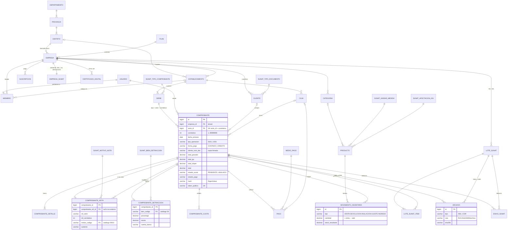

# Al Toque · facturación electrónica

> Emite boletas y facturas electrónicas desde tu celular en segundos. Sin enredos, sin papeleo.

Sistema de facturación electrónica SUNAT y punto de venta para bodegas, ferreterías, boticas, restaurantes, talleres
y estudios contables: boletas, facturas, notas de crédito y débito, anulaciones, detracciones, crédito con cuotas,
caja con Yape/Plin, inventario con kardex y varios negocios por cuenta.

**En línea:** https://altoque-pe.vercel.app · demo `demo@altoque.pe` / `altoque123` (SUNAT de pruebas)

| Parte | Tecnología |
|---|---|
| `backend/` | Java 21 · Spring Boot 3.5 · JPA · Flyway · MariaDB (H2 en desarrollo) · JWT |
| `frontend/` | Angular 21 (standalone, signals, zoneless) · CSS propio con la marca Al Toque |
| `marketing/` | Video diario automático (n8n + IA + renderizador) |
| SUNAT | XML UBL 2.1 propio, firma XMLDSig, cliente SOAP `billService` y `billConsultService` |

Probado contra **SUNAT beta**: boletas (cliente varios, con DNI, exoneradas, con ICBPER), facturas al contado, al crédito
con cuotas y **con detracción**, notas de crédito y débito, resumen diario de anulación y comunicación de baja: todas aceptadas.

---

## Arrancar

```bash
# Windows: doble clic en iniciar.bat (enciende Docker, levanta todo y abre http://localhost:8081)

# Desarrollo
cd backend && mvn spring-boot:run          # API en :8080, base H2 en ./backend/data
cd frontend && npm install && npm start     # web en :4200, /api → :8080

# Pruebas
cd backend && mvn test                                   # unitarias + flujos completos en modo simulado
SUNAT_BETA=1 mvn test -Dtest=SunatBetaTest               # envío real a SUNAT beta
```

---

## Procesos SUNAT

| Proceso | Regla que se valida antes de firmar |
|---|---|
| Emisión | Fecha de emisión = hoy. Factura solo con RUC válido (dígito verificador). Boleta desde S/ 700 exige documento. Serie bloqueada con `SELECT … FOR UPDATE`; el correlativo se toma al final para no dejar huecos. |
| Crédito | Factura al crédito con cuotas (obligatorio desde 2021), vencimientos posteriores a la emisión, cuotas que suman el neto pendiente. |
| Detracción (SPOT) | Solo factura de más de S/ 700, con cuenta del Banco de la Nación configurada. Tipo de operación 1001, leyenda 2006, `PaymentMeans` y `PaymentTerms`; monto en soles enteros; cuotas y cobros sobre el neto. |
| Notas | Sobre una boleta o factura aceptada, misma familia de serie (B/F), motivo del catálogo 09/10, sin pasar lo acreditable. «Error en el RUC» solo para facturas. |
| Envío | `sendBill`. CDR 0 → aceptado; 4000+ → observado; 2000–3999 → rechazado (número consumido, stock repuesto); 0100–1999 o sin respuesta → pendiente y reintento automático (hasta 12 veces, cada 5 min). 1033 «registrado previamente» → en producción se recupera el CDR con `getStatusCdr`. |
| Anulación | Hasta 7 días calendario: boletas y sus notas por resumen diario (RC), facturas y sus notas por comunicación de baja (RA), con ticket que se consulta solo. Después, nota de crédito. Al aceptarse, el stock se repone. |
| Conservación | XML firmados y CDR en disco (`ARCHIVOS_DIR`), con SHA-256 verificado al leer. Descarga mensual en ZIP para el contador. |

Ambientes por empresa: `SIMULADO` (firma sin enviar), `BETA` (SUNAT de pruebas, certificado autogenerado),
`PRODUCCION` (certificado `.pfx` propio y usuario SOL secundario; claves cifradas con AES-GCM).

---

## Modelo de datos (DER)

Migraciones en `backend/src/main/resources/db/migration`: `V1__esquema.sql` (estructura), `V2__catalogos_sunat.sql`,
`V3__ubigeo.sql` (1,875 distritos INEI) y `V4__planes.sql`.

**Criterios:** tercera forma normal (lo calculable no se guarda: monto en letras, nombre de archivo, saldo, intentos,
diferencia de caja, departamento y provincia de un ubigeo); catálogos SUNAT como tablas con FK (la base rechaza un código
inválido); `empresa_id` como clave de tenant con FK compuestas que impiden mezclar datos de dos negocios; CHECKs de montos,
estados y formatos; binarios fuera de la base.
Excepciones deliberadas e inmutables: el comprobante copia los datos del receptor y del producto, y guarda sus totales tal como se firmaron.



| Grupo | Tablas |
|---|---|
| Referencia | `sunat_tipo_comprobante` (01), `sunat_tipo_documento` (06), `sunat_afectacion_igv` (07), `sunat_unidad_medida` (03), `sunat_motivo_nota` (09/10), `sunat_bien_detraccion` (54), `medio_pago` (59), `departamento`, `provincia`, `distrito` |
| Negocio | `plan`, `empresa`, `empresa_sunat`, `suscripcion`, `certificado_digital`, `establecimiento`, `serie` |
| Personas | `usuario` (una persona = un correo), `miembro` (rol y local en cada negocio: un contador entra a varios RUC) |
| Catálogo | `cliente`, `categoria`, `producto`, `movimiento_inventario` |
| Ventas | `caja`, `comprobante`, `comprobante_nota`, `comprobante_detraccion`, `comprobante_detalle`, `comprobante_cuota`, `pago` |
| SUNAT | `lote_sunat`, `lote_sunat_item`, `archivo`, `envio_sunat` |

---

## Despliegue (Dokploy)

Proyecto `altoque` en Dokploy:

| Servicio | Qué es |
|---|---|
| `altoque-db` | MariaDB 11.4 (`utf8mb4`, zona −05:00). Flyway crea todo al arrancar. |
| `altoque-api` | `backend/` (Dockerfile). Volumen `altoque-archivos` en `/data/archivos` (XML y CDR: respáldalo). |
| `altoque-web` | `frontend/` (nginx). `API_UPSTREAM=http://<app de la API>:8080`. |

HTTPS: proxy en Vercel (`altoque-pe.vercel.app`) que reenvía al dominio interno de la web.

Variables de la API: `DB_HOST`, `DB_PORT`, `DB_NAME`, `DB_USER`, `DB_PASSWORD`, `JWT_SECRET`, `APP_CRYPTO_KEY`, `FRONTEND_URL`,
`API_PUBLIC_URL`, `CORS_ORIGINS`, `ARCHIVOS_DIR`; opcionales `APIPERU_TOKEN` (DNI/RUC), `MP_ACCESS_TOKEN` (cobro de planes), `ALTOQUE_DEMO`.

Para actualizar: zip de `backend/` o `frontend/` y `application.dropDeployment` (o sube el zip desde el panel).

## Antes de vender en serio

- Precios (con IGV, `V4__planes.sql`): Caserito S/ 39, Negociante S/ 69, Empresa S/ 139 al mes; anual = 10 meses.
- Cada negocio pasa a producción en **Ajustes › SUNAT**: sube su `.pfx`, su usuario SOL secundario y elige *Producción*.
- Pon `ALTOQUE_DEMO=false` cuando ya no necesites la cuenta demo.
