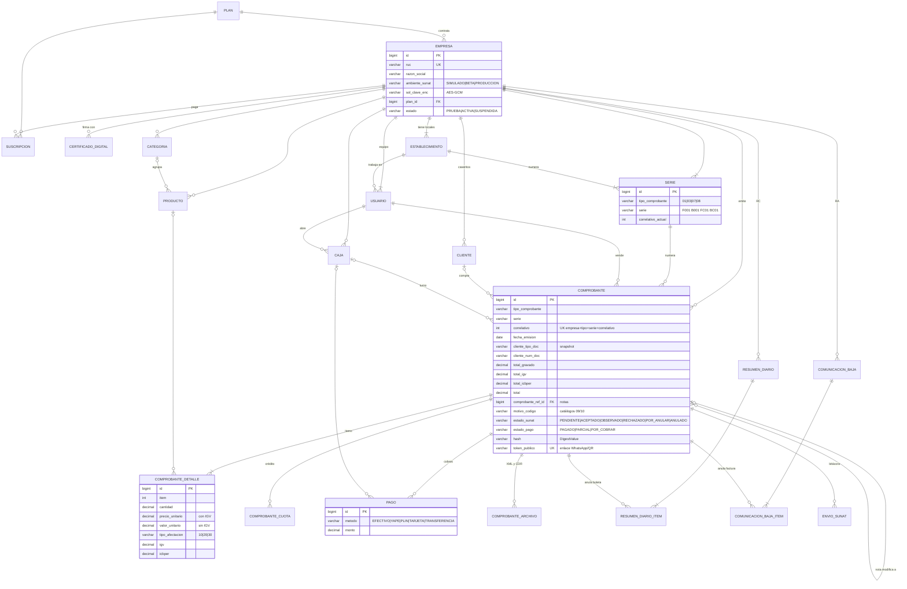

# Al Toque · facturación electrónica

> Emite boletas y facturas electrónicas desde tu celular en segundos. Sin enredos, sin papeleo.

Sistema de facturación electrónica SUNAT (Perú) para bodegas, restaurantes, talleres y empresas:
boletas, facturas, notas de crédito y débito, anulaciones (resumen diario y comunicación de baja),
caja del día, reportes y envío por WhatsApp.

| Parte | Tecnología |
|---|---|
| `backend/` | Java 21 · Spring Boot 3.5 · JPA · Flyway · MariaDB (H2 en desarrollo) · JWT |
| `frontend/` | Angular 21 (standalone, signals, zoneless) · CSS propio con la marca Al Toque |
| SUNAT | XML UBL 2.1 propio, firma XMLDSig, cliente SOAP `billService` (beta y producción) |

Probado contra **SUNAT beta**: boletas (cliente varios, con DNI, exoneradas, con ICBPER), facturas al contado y al crédito
con cuotas, notas de crédito y débito, resumen diario de anulación y comunicación de baja — todas aceptadas.

---

## Arrancar en desarrollo

```bash
# API (puerto 8080, base H2 en ./backend/data, crea el negocio demo)
cd backend && mvn spring-boot:run

# Web (puerto 4200, /api se reenvía al 8080)
cd frontend && npm install && npm start
```

Entra a http://localhost:4200 → **Ingresar → Usar demo** (`demo@altoque.pe` / `altoque123`).
El demo emite contra SUNAT beta con el RUC de pruebas `20000000001`.

## Con Docker (MariaDB + API + web)

En Windows basta con doble clic en `iniciar.bat`: enciende Docker Desktop, levanta todo y abre http://localhost:8081.

```bash
cp .env.example .env      # cambia las claves
docker compose up --build # http://localhost:8081
```

## Pruebas

```bash
cd backend && mvn test                                   # unitarias + flujo completo en modo simulado
SUNAT_BETA=1 mvn test -Dtest=SunatBetaTest               # envío real a SUNAT beta
```

---

## Cómo funciona la emisión

1. **Emitir** valida reglas SUNAT (factura exige RUC; boleta ≥ S/ 700 exige documento; cuotas suman el total),
   bloquea la serie (`SELECT … FOR UPDATE`) y toma el correlativo al final para no dejar huecos.
2. Calcula valor unitario, IGV e ICBPER desde el precio con IGV (IGV de línea = total − valor de venta, cuadra al céntimo).
3. Arma el XML UBL 2.1, lo firma con el certificado de la empresa y lo guarda (`comprobante_archivo`).
4. Lo envía con `sendBill`, guarda el CDR y deja el estado en `ACEPTADO`, `OBSERVADO` o `RECHAZADO`.
   Si SUNAT no responde queda `PENDIENTE` y un proceso lo **reintenta cada 5 minutos**.
5. Anular: boletas por **resumen diario** (RC), facturas por **comunicación de baja** (RA), con ticket que se consulta solo.

Ambientes por empresa: `SIMULADO` (firma sin enviar), `BETA` (SUNAT de pruebas, certificado autogenerado),
`PRODUCCION` (exige certificado `.pfx` propio y usuario SOL secundario; las claves se guardan cifradas con AES-GCM).

---

## Modelo de datos (DER)

El esquema vive en `backend/src/main/resources/db/migration` (Flyway). Todo dato de negocio cuelga de `empresa` (multiempresa).
Los comprobantes guardan **copia** de los datos del cliente y del producto: lo emitido no cambia si luego editas el catálogo.



| Tabla | Para qué |
|---|---|
| `plan`, `suscripcion` | Planes Caserito / Negociante / Empresa, límites y cobros (Mercado Pago opcional) |
| `empresa`, `certificado_digital` | Emisor, ambiente SUNAT, credenciales SOL y `.pfx` cifrados |
| `establecimiento`, `serie` | Locales (código SUNAT 0000…) y numeración por tipo |
| `usuario` | Dueño, administrador o vendedor |
| `cliente`, `categoria`, `producto` | Catálogo (precio con IGV, afectación, ICBPER, stock, favoritos) |
| `caja` | Apertura, cobros del turno y cuadre al cierre |
| `comprobante`, `comprobante_detalle`, `comprobante_cuota`, `pago`, `comprobante_archivo` | Boletas, facturas y notas con sus ítems, cuotas, cobros, XML y CDR |
| `resumen_diario(_item)`, `comunicacion_baja(_item)` | Anulaciones enviadas por ticket |
| `envio_sunat` | Bitácora de cada llamada a SUNAT |

---

## Despliegue (Dokploy)

- **Base de datos**: MariaDB 10.6+ (`utf8mb4`). Flyway crea las tablas al arrancar.
- **API** (`backend/`, perfil `prod`): variables `DB_HOST`, `DB_PORT`, `DB_NAME`, `DB_USER`, `DB_PASSWORD`,
  `JWT_SECRET`, `APP_CRYPTO_KEY`, `FRONTEND_URL`, `API_PUBLIC_URL`, `CORS_ORIGINS`; opcionales `APIPERU_TOKEN`, `MP_ACCESS_TOKEN`, `ALTOQUE_DEMO`.
- **Web** (`frontend/`): nginx con `API_UPSTREAM` apuntando al servicio de la API (p. ej. `http://altoque-api:8080`).

## Antes de vender en serio

- Precios (incluyen IGV, `V3__precios_mercado.sql`): Caserito S/ 39, Negociante S/ 69, Empresa S/ 139 al mes; anual = 10 meses.
  Para cambiarlos crea una migración nueva o edita la tabla `plan`.
- Cambia los datos de contacto del pie de la landing (`hola@altoque.pe`).
- Cada negocio pasa a producción en **Ajustes › SUNAT**: sube su `.pfx`, su usuario SOL secundario y elige *Producción*.
